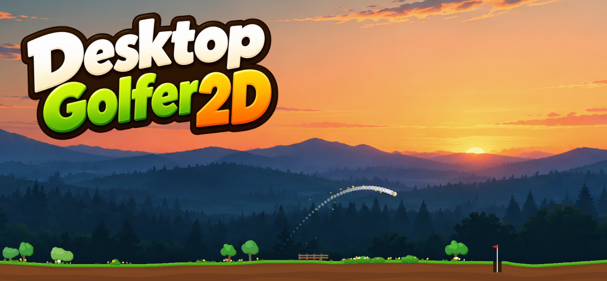

# Desktop Golfer 2D

{: .page-image}

A side-view golf game played along the bottom of your desktop, for a break between tasks.

## How to Play

- Drag from anywhere on the ground toward where you want the ball to go, and let go to shoot.
- Hit the ball high to put backspin on it, so it stops sooner on the green.
- Play on from where the ball stops, until it drops in the cup.
- Clicks on the sky go through to the windows behind, so you can keep working with the course on the screen.

  <iframe src="https://www.youtube-nocookie.com/embed/Iupj5qyTZxQ" title="Desktop Golfer 2D gameplay video" loading="lazy" allow="accelerometer; autoplay; clipboard-write; encrypted-media; gyroscope; picture-in-picture; web-share" referrerpolicy="strict-origin-when-cross-origin" allowfullscreen></iframe>

## FAQ

### How do I open the menu?

Right-click the course, or click the icon of the game in the menu bar.

### How do I quit?

Choose "Quit Desktop Golfer 2D" from the menu.

### The course is hidden behind other windows.

Turn on "Keep on Top" in the menu.

### I want to play on another display.

Choose the display from "Display" in the menu.

### A hole is too hard.

Choose "Skip Hole" from the menu to go on to the next one, or "Restart Hole" to try it again.

### Where is my record kept?

On your Mac, in the game's own data folder. See the [Privacy Policy](/desktop-golfer/privacy_policy.html).

## Support

For questions, problems or suggestions, write to [support@xord.org](mailto:support@xord.org).
Including the versions of the game and macOS helps.

- [Privacy Policy](/desktop-golfer/privacy_policy.html)

----

&copy; 2026 xord.org
