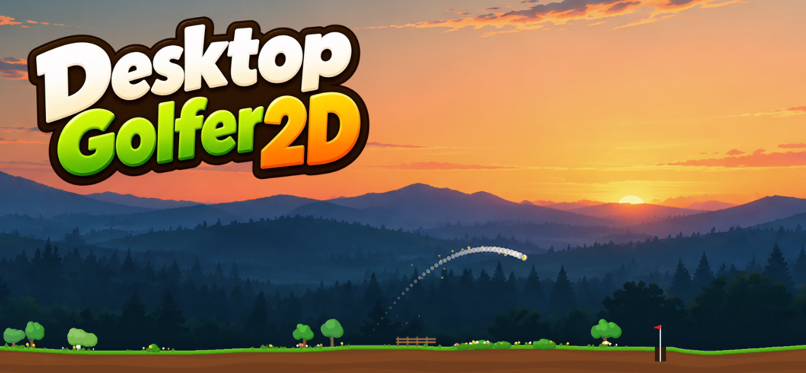

# Desktop Golfer 2D

{: .page-image}

デスクトップの下端で遊ぶ、横から見るゴルフゲームです。仕事の合間のひと息に。

## 遊び方

- 地面のどこからでも、打ちたい方へドラッグして放すと打てます。
- 高く打ち上げるとバックスピンがかかり、グリーンで止まりやすくなります。
- 止まった所から打ち直し、カップに入ればホールアウトです。
- 空の部分のクリックは後ろのウィンドウに届くので、コースを出したまま作業を続けられます。

  <iframe src="https://www.youtube-nocookie.com/embed/Iupj5qyTZxQ" title="Desktop Golfer 2D のプレイ動画" loading="lazy" allow="accelerometer; autoplay; clipboard-write; encrypted-media; gyroscope; picture-in-picture; web-share" referrerpolicy="strict-origin-when-cross-origin" allowfullscreen></iframe>

## ダウンロード

Mac App Store で配信しています。

## よくある質問

### メニューはどこにありますか？

コースを右クリックするか、メニューバーのゲームのアイコンをクリックしてください。

### 終了するには？

メニューの「Desktop Golfer 2D を終了」を選んでください。

### コースがほかのウィンドウに隠れてしまいます。

メニューの「最前面に表示」をオンにしてください。

### 別のディスプレイで遊びたい。

メニューの「ディスプレイ」から選んでください。

### 難しすぎるホールがあります。

メニューの「ホールをスキップ」で次のホールへ進めます。「ホールをやり直す」でもう一度試すこともできます。

### 記録はどこに保存されますか？

お使いの Mac の、このゲーム専用のデータ用フォルダーに保存します。[プライバシーポリシー](/desktop-golfer/privacy_policy.html)をご覧ください。

## サポート

ご質問、不具合、ご要望は [support@xord.org](mailto:support@xord.org) までお送りください。ゲームと macOS のバージョンを添えていただけると助かります。

- [プライバシーポリシー](/desktop-golfer/privacy_policy.html)

----

&copy; 2026 xord.org
